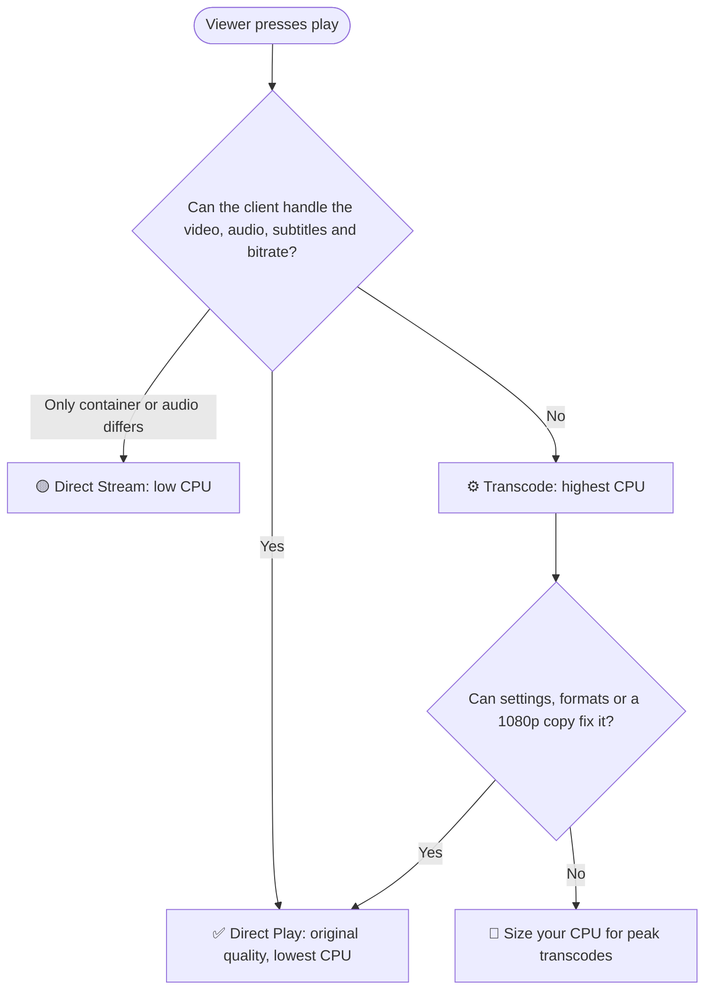

  
# 🎬 Direct Play vs Transcoding: Which is Best for Plex Server? 2026 Guide
 
### Stop guessing your CPU needs. Learn how Plex really delivers video, and size your server with confidence.
 

 

---
 
> [!TIP]
> **🧠 TL;DR:** **Direct play is the best choice whenever your clients can handle it.** It keeps original quality and barely touches the CPU. **Transcoding is the fallback** for slow connections, old devices, and bitrate caps, and it is the most CPU hungry job on a Plex server. Plan to reduce transcoding first, then size your CPU for what is left. For a ready made home for your server, see QloudHost's [Plex VPS Hosting](https://qloudhost.com/offshore-vps-hosting/plex). 👇
 
---
 
Here is a scene almost every Plex owner has lived through. You buy a faster server, the dashboard shows two people watching, and the CPU graph still hits 100%. Meanwhile, a friend runs five streams on a modest box and barely notices.
 
The difference is rarely the hardware. It is whether Plex is playing your files as they are, or rebuilding them on the fly for every viewer.
 
That single distinction decides how much CPU you need, how much bandwidth you burn, and how much money you should spend. Get it right, and you can size your server with confidence. Get it wrong, and you either overpay or fight buffering for months. 🎯
 
## 📑 Table of Contents
 
- [⚡ Quick Summary](#-quick-summary)
- [🎬 What Are Direct Play, Direct Stream and Transcoding?](#-what-are-direct-play-direct-stream-and-transcoding)
- [🏆 Direct Play vs Transcoding: Which Is Best?](#-direct-play-vs-transcoding-which-is-best)
- [🔍 Why Does Plex Transcode in the First Place?](#-why-does-plex-transcode-in-the-first-place)
- [🧠 How Much CPU Does Transcoding Really Need?](#-how-much-cpu-does-transcoding-really-need)
- [💻 Software vs Hardware Transcoding on a VPS](#-software-vs-hardware-transcoding-on-a-vps)
- [🔧 Seven Ways to Reduce Transcoding Before Buying More CPU](#-seven-ways-to-reduce-transcoding-before-buying-more-cpu)
- [🎯 How to Pick the Right CPU: A Simple Method](#-how-to-pick-the-right-cpu-a-simple-method)
- [📡 Bandwidth: The Other Half of the Equation](#-bandwidth-the-other-half-of-the-equation)
- [🚀 Where QloudHost Fits: Plex VPS and DMCA Ignored Streaming Servers](#-where-qloudhost-fits-plex-vps-and-dmca-ignored-streaming-servers)
- [❓ Frequently Asked Questions](#-frequently-asked-questions)
- [✅ Conclusion](#-conclusion)
## ⚡ Quick Summary
 
Short on time? These are the points that matter most. Everything else in this guide expands on them.
 
- ✅ **Direct play** sends your file untouched, so it needs almost no CPU.
- ⚙️ **Transcoding** re-encodes the video in real time, and it is the heaviest job a Plex server does.
- 📊 Plex's own guidance puts one 1080p transcode at roughly **2,000 PassMark points**, and one 4K HDR transcode at roughly **17,000**.
- 💻 A VPS has no graphics card, so it uses **software transcoding**, which makes CPU choice critical.
- 🎯 The smartest strategy: **reduce transcoding first**, then size the CPU for what is left.
## 🎬 What Are Direct Play, Direct Stream and Transcoding?
 
Plex can deliver a video in three different ways. Each one puts a different load on your server.
 
Understanding these three modes is the foundation for every CPU decision that follows.
 
### 🟢 Direct Play
 
The client device plays the original file exactly as it is stored. The server simply reads the file and sends it over the network.
 
This is the best case. There is no quality loss, and the CPU barely moves.
 
### 🟡 Direct Stream
 
The video is left untouched, but the container or the audio is converted. For example, an MKV file may be repackaged, or a rare audio format may be converted to a common one.
 
This costs a little CPU, but far less than a full transcode.
 
### 🔴 Transcoding
 
Here the server decodes the video and encodes it again into a format, resolution, or bitrate the client can handle. This happens in real time, for every viewer who needs it.
 
It is the heaviest job, and the one your CPU choice should be built around.
 
| Mode | What Plex Does | CPU Load | Quality |
|---|---|---|---|
| 🟢 Direct Play | Sends the original file | Very low | Original |
| 🟡 Direct Stream | Repackages container or audio | Low | Original video |
| 🔴 Transcode | Re-encodes video in real time | High | Reduced or adjusted |
 
Here is how Plex effectively decides, shown as a simple flow:
 

 
## 🏆 Direct Play vs Transcoding: Which Is Best?
 
Short answer: **direct play is best whenever it is possible.** Transcoding is a powerful fallback, not a goal.
 
Think of direct play as your default and transcoding as the exception you plan for.
 
| Factor | 🟢 Direct Play | 🔴 Transcoding |
|---|---|---|
| Video quality | Original, untouched | Can drop, depending on settings |
| CPU load | Very low | High |
| Bandwidth use | Full file bitrate | Can be much lower |
| Device compatibility | Needs a capable client | Works on almost any device |
| Start time | Fast | Slightly slower |
| Best for | Strong clients, local or fast connections | Old devices, slow connections, bitrate caps |
 
### ✅ When Direct Play Wins
 
- Your clients are modern and support your file formats
- Viewers have fast, stable connections
- You want the best possible picture and sound
- You want to keep CPU costs low
### ✅ When Transcoding Is the Better Choice
 
- A viewer is on a slow or mobile connection
- The device cannot decode your video codec
- You need to protect a limited bandwidth quota
- Subtitles must be burned in for a client that cannot display them
**The honest verdict:** build your library and client setup so direct play is the default. Then size your server for the transcodes that remain.
 
## 🔍 Why Does Plex Transcode in the First Place?
 
Many owners assume transcoding only happens with old devices. In reality, a handful of everyday situations trigger it.
 
Knowing these triggers is the fastest way to cut your CPU needs.
 
1. 🎞️ **Unsupported video codec.** A client that cannot decode HEVC (H.265) or AV1 forces Plex to convert the video.
2. 📉 **Bitrate or quality limits.** If a remote viewer is on a slow connection, or their app is set to a lower quality, Plex converts the file to fit.
3. 📐 **Resolution mismatch.** Sending 4K to a device that only displays 1080p often leads to a conversion.
4. 🌈 **HDR and Dolby Vision.** Showing HDR content on a screen that cannot display it requires tone mapping, one of the heaviest tasks in software.
5. 💬 **Subtitles.** Many clients cannot display image based subtitles such as PGS, so Plex burns them into the video. This forces a full video transcode even when everything else is compatible.
6. 🔊 **Audio formats.** Some audio tracks need conversion, which usually only triggers direct stream, but can add load.
> [!NOTE]
> Plex's own support documentation points out that remote access very often requires transcoding, because the viewer's network speed often cannot support the full quality of the file. That matters a lot if your server lives in a data center and every stream is remote.
 
## 🧠 How Much CPU Does Transcoding Really Need?
 
Plex publishes rough PassMark guidelines for a single full transcode. PassMark is a public benchmark that gives every processor a score you can look up easily.
 
Here are Plex's published figures for one transcoding stream:
 
| 🎞️ Source File | 📊 Approximate PassMark Needed |
|---|---|
| 720p, 4 Mbps, H.264 | 1,500 |
| 1080p, 10 Mbps, H.264 | 2,000 |
| 4K SDR, 40 Mbps, 8-bit HEVC | 12,000 |
| 4K HDR, 50 Mbps, 10-bit HEVC | 17,000 |
 
The 4K figures assume the file is transcoded down to a 10 Mbps 1080p stream.
 
### ⚠️ Three Things These Numbers Do Not Tell You
 
- **They are per stream.** Three simultaneous 1080p transcodes need roughly three times the budget.
- **Single thread speed matters.** Plex notes that total score is important, but so is single thread performance. A CPU with many slow cores can disappoint.
- **They are guidelines, not guarantees.** Codecs, subtitles, and settings all shift real world results. Treat them as a starting point and always leave headroom.
## 💻 Software vs Hardware Transcoding on a VPS
 
Hardware transcoding hands the heavy work to a graphics chip, such as Intel Quick Sync or an NVIDIA GPU. It is very efficient, and it also requires a Plex Pass.
 
A standard VPS does not include a GPU, so Plex falls back to software transcoding on the CPU. That is perfectly workable, but it changes how you plan.
 
**What this means for you:**
 
- ✅ Direct play is unaffected, so a VPS is excellent for it.
- 🔁 A few simultaneous 1080p transcodes are very manageable on a modern multi core CPU.
- 🎬 Multiple 4K HDR transcodes are demanding, and may be better suited to a dedicated server.
- 💡 Dedicated vCPU cores matter more than headline core counts, because shared cores can slow down when neighbours get busy.
## 🔧 Seven Ways to Reduce Transcoding Before Buying More CPU
 
The cheapest CPU upgrade is the one you never need. Try these steps first, in this order.
 
1. 🎚️ **Set clients to the original quality.** In each Plex app, avoid low quality caps, and enable direct play and direct stream where available.
2. 📦 **Use compatible formats.** H.264 video with AAC or AC3 audio plays almost everywhere without conversion.
3. 💬 **Prefer text subtitles.** SRT subtitles are far lighter than image based formats that must be burned in.
4. 🗂️ **Keep a 1080p copy of your big 4K files.** Plex's Optimize feature, or a tool like FFmpeg or HandBrake, can create these versions ahead of time. You shift the work to quiet hours instead of live streaming.
5. 📺 **Use stronger client devices.** A dedicated streaming box or modern smart TV direct plays far more than a browser or an old stick.
6. ⚡ **Put the transcode folder on fast storage.** NVMe drives, or even RAM, keep temporary files from slowing down streams.
7. 👀 **Watch the Plex Dashboard.** It shows whether each stream is direct play, direct stream, or transcode, so you can find the real culprits.
## 🎯 How to Pick the Right CPU: A Simple Method
 
Now we can size the server. This five step method works for any setup, from a small family server to a shared library.
 
**Step 1: List your clients.** 📋 Note every device that will connect, and what each can direct play.
 
**Step 2: Count peak transcodes, not total users.** 👥 Ten users do not mean ten transcodes. Count how many are likely to stream at the same moment and need conversion.
 
**Step 3: Pick the heaviest typical file.** 🎞️ Use the PassMark table above to find the need per stream.
 
**Step 4: Multiply and add headroom.** ➕ Multiply the per stream need by peak transcodes, then add around 30% for background tasks like library scans and metadata.
 
**Step 5: Test with real files.** 🧪 Start a few streams, watch CPU usage in a tool like `htop`, and adjust. A short test beats any spreadsheet.
 
### 🧭 A Practical Starting Point
 
This is a rule of thumb based on the guidance above. Always confirm with your own files.
 
| 🎬 Your Workload | 🖥️ Suggested Starting Point |
|---|---|
| Mostly direct play, 1 to 3 viewers | 2 vCPU |
| 1 to 2 simultaneous 1080p transcodes | 4 vCPU |
| 3 to 4 simultaneous 1080p transcodes | 6 vCPU |
| Several transcodes plus occasional 4K | 8 vCPU or a dedicated server |
 
## 📡 Bandwidth: The Other Half of the Equation
 
CPU is only one side of the balance. Transcoding costs processing power, but it saves bandwidth.
 
Consider the math. A 4K file at 60 Mbps uses about **27 GB per hour** when direct played. The same movie transcoded to 10 Mbps uses about **4.5 GB per hour**, which is six times less.
 
| Stream | Bitrate | Data per Hour |
|---|---|---|
| 4K direct play | 60 Mbps | about 27 GB |
| 1080p high quality | 20 Mbps | about 9 GB |
| 1080p transcoded | 10 Mbps | about 4.5 GB |
 
If your server has a monthly bandwidth quota, this trade off matters. Direct play protects your CPU, and transcoding protects your data allowance. The best setup depends on which resource you have more of.
 
## 🚀 Where QloudHost Fits: Plex VPS and DMCA Ignored Streaming Servers
 
Once you know your workload, you need hosting that matches it. QloudHost offers two practical routes depending on how heavy your streaming is.
 
Both run in QloudHost's Tier III data center in Amsterdam, Netherlands, with a privacy focused offshore setup.
 
### ⚡ Plex VPS Hosting for Direct Play and Light Transcoding
 
QloudHost's [Plex VPS Hosting](https://qloudhost.com/offshore-vps-hosting/plex) runs on KVM virtualization with AMD EPYC processors and dedicated vCPU cores. Storage is NVMe, the network port is 1 Gbps+, and every plan includes a dedicated IPv4 address and full root access.
 
| 📦 Plan | 🧠 CPU | 💾 RAM | ⚡ NVMe | 📡 Bandwidth | 💰 2-Year Price |
|---|---|---|---|---|---|
| 🥉 VPS Entry | 2 vCPU | 4 GB | 50 GB | 1 TB | **$17.99/mo** |
| 🥈 VPS Value | 4 vCPU | 8 GB | 120 GB | 1.75 TB | **$43.99/mo** |
| 🥇 VPS Business | 6 vCPU | 12 GB | 150 GB | 2 TB | **$52.99/mo** |
| 💎 VPS Enterprise | 8 vCPU | 16 GB | 200 GB | 2.5 TB | **$71.99/mo** |
 
These plans map neatly to the sizing table above. You can start small, test your real streams, and upgrade CPU, RAM, and storage later without losing your data or IP address. Every plan is covered by a 14 day money-back guarantee, which makes a real world test low risk.
 
### 🛡️ DMCA Ignored Streaming Servers for Heavy Workloads
 
If you outgrow a VPS, for example with many simultaneous transcodes, a large library, or high volume streaming, QloudHost's [Offshore Streaming Servers](https://qloudhost.com/offshore-dedicated-servers/streaming-hosting) and [DMCA Ignored Dedicated Servers](https://qloudhost.com/dmca-ignored-dedicated-servers) give you a whole machine with far more CPU and storage headroom. For encoding heavy pipelines, there is also dedicated [FFmpeg hosting](https://qloudhost.com/ffmpeg-hosting).
 
DMCA ignored hosting means your server is handled under Dutch and EU law rather than US DMCA procedures. It is a hosting and jurisdiction choice, not a license to host content you do not own.
 
> [!IMPORTANT]
> Only host media you own or have the rights to stream. Offshore hosting does not change copyright law, and illegal content is never acceptable.
 
## ❓ Frequently Asked Questions
 

<b>1️⃣ What is the difference between direct play and direct stream?</b>

 
Direct play sends the original file untouched. Direct stream keeps the video as is but repackages the container or converts the audio. Direct stream costs slightly more CPU, but far less than a transcode.
 

<b>2️⃣ Does transcoding reduce video quality?</b>

 
It can. Re-encoding to a lower bitrate or resolution always involves some loss, and the effect depends on the settings. Direct play keeps the original quality, which is why it is the preferred mode.
 

<b>3️⃣ Can a VPS do hardware transcoding for Plex?</b>

 
A standard VPS has no GPU, so Plex uses software transcoding on the CPU. Hardware transcoding also requires a Plex Pass. For heavy transcoding, choose more vCPU cores or move to a dedicated server.
 

<b>4️⃣ How many simultaneous transcodes can my CPU handle?</b>

 
Divide your CPU's PassMark score by the per stream figure for your files, then leave around 30% headroom. For example, a 1080p H.264 stream needs about 2,000 points according to Plex. Always confirm with a real test.
 

<b>5️⃣ Why does Plex transcode when my TV supports the file?</b>

 
The usual causes are a quality or bitrate cap in the app, burned in subtitles, an unsupported audio track, or an HDR format the screen cannot show. Check the Plex Dashboard to see the exact reason.
 

<b>6️⃣ Is 4K transcoding realistic on a VPS?</b>

 
It is possible, but demanding. Plex's guidance of about 17,000 PassMark for one 4K HDR transcode shows how heavy it is. A better approach is to direct play 4K, and keep 1080p versions for devices that cannot handle it.
 

<b>7️⃣ Is it legal to run Plex on a DMCA ignored server?</b>

 
Running Plex for media you own or have rights to is generally fine. DMCA ignored hosting only changes the jurisdiction your server is handled under. It does not make unlicensed content legal.
 

## ✅ Conclusion
 
So, which is best for your Plex server? Direct play wins whenever your clients can handle it, and transcoding is the tool you plan for when they cannot.
 
Start by reducing transcoding with compatible formats, good clients, and sensible quality settings. Then use Plex's PassMark guidance, add headroom, and test with your real files.
 
If you want a hosting platform that matches that approach, QloudHost's [Plex VPS Hosting](https://qloudhost.com/offshore-vps-hosting/plex) gives you AMD EPYC performance, NVMe storage, and a 1 Gbps+ network starting at $17.99/month. And when your library or audience grows, QloudHost's DMCA ignored streaming and dedicated servers are ready for the next step. 🚀
 

  
### 🚀 Ready to host your Plex server offshore?
 

 

> [!IMPORTANT]
> **Found this guide useful?** ⭐ Star this repository, 🍴 share it with a fellow Plex fan, and drop your questions in the Issues tab. Happy streaming! 🎉
